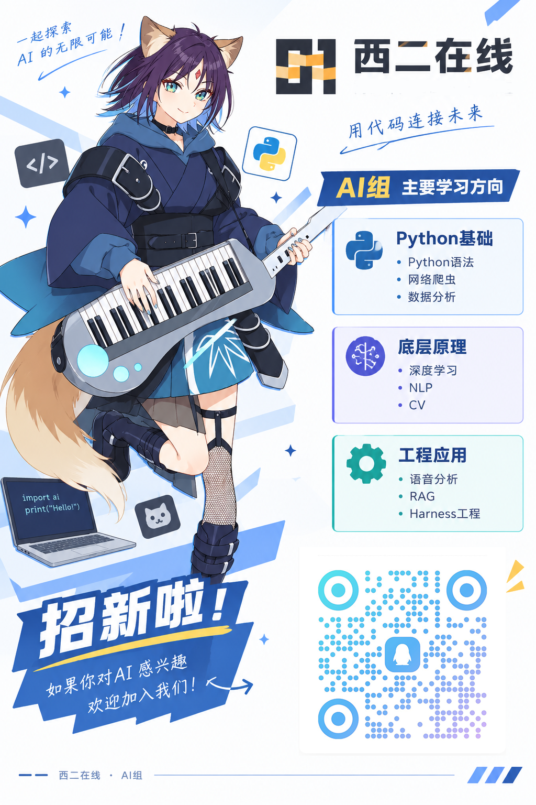

# west2-online AI 考核指南

这里是西二在线工作室 AI 方向的考核指南，旨在为初学者提供一个循序渐进的 AI 学习路线。

## 版权声明

本项目遵循 GPL-3.0 License，如需转载，请注明本项目仓库地址。

## 如何开始

请进入 [work-2026](./docs/work-2026) 文件夹，从 [Foundation](./docs/work-2026/foundation) 中的 [Foundation 0](./docs/work-2026/foundation/foundation0.md) 开始学习。

我们希望学习方式是“文档引导 + 个人自学”。我们会告诉你应当如何快速上手，但你想要学好、学懂，除了我们的引导外，还需要主动进行个人提升。

从功利的角度出发，如果你想进入 west2-online 工作室，在完成基础内容后，还需要适当完成一定量的 Bonus 内容。

我们的答辩会考察你一定的知识储备。

## 作业提交方式

你需要阅读 [作业提交指南](./docs/commit/work-commit.md) 来了解作业提交的具体要求和流程。

你还需要阅读 [Git 使用指南](./docs/commit/git-study.md) 来了解 Git 的使用方法。

此外，由于 AI 在不断发展，作业内容在不断变化，可能你做着做着作业内容就全变了。

所以请时刻关注本仓库。

## 成为正式成员后的权益

通过所有考核后，你将成为西二在线网络工作室的正式成员，并获得以下权益：

- 成员证书
- 使用工作室的计算资源，组队参与算法竞赛
- 获得外包项目与企业实习机会
- 拥有固定的个人工位及活动室使用权
- 参与科研合作项目
- ~~玩无人机~~

## 详细说明

更多关于考核设计的思考，请参考 [ShaddockNH3 的博客](https://blog.attilio.cc/posts/ai/thoughts-2026/)。

这篇博客还有一部分没有更新完，待 ShaddockNH3 有时间再维护。

## 致谢

感谢 [ShaddockNH3](https://github.com/ShaddockNH3)，[JadeMelody](https://github.com/wjord2023)，[Schariac125](https://github.com/Schariac125)，[Longxi Zheng](https://github.com/REREREGO)，[Cai](https://github.com/ACaiCat)，[柠檬味氨水](https://github.com/weijianxian)，[Tomori Nao](https://github.com/TomoriNaoiy)，对 2026 / 2025 / 2024 版考核的贡献。

## 加入我们

欢迎扫码加入 AI 方向学习交流群，与其他学习者共同进步。

