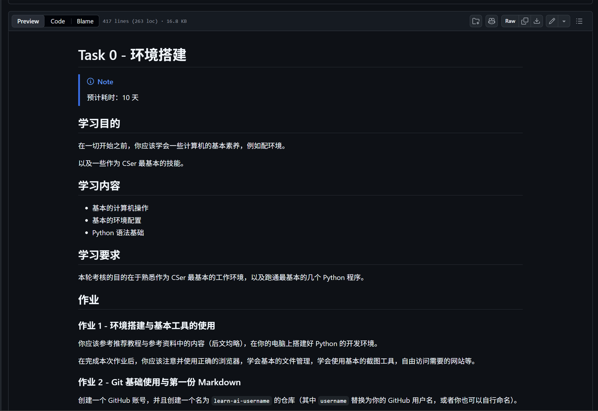

# Crazy Day 记录

这是我的一次疯狂又充实的一天。

## 上午安排

早起完成任务，开启全新的一天。

### 任务清单

| 时间段 | 任务 | 完成状态 |
| ---- | ---- | ---- |
| 08:00 | 起床,吃早餐,上早八 | ✅ |
| 09:00 | 学习 Git 与 GitHub | ✅ |
| 11:00 | 写 task0 作业 | ⏳ |

## 插入图片



## 一段测试代码

```python
# 打印一句话
print("Hello, this is my crazy day!")
